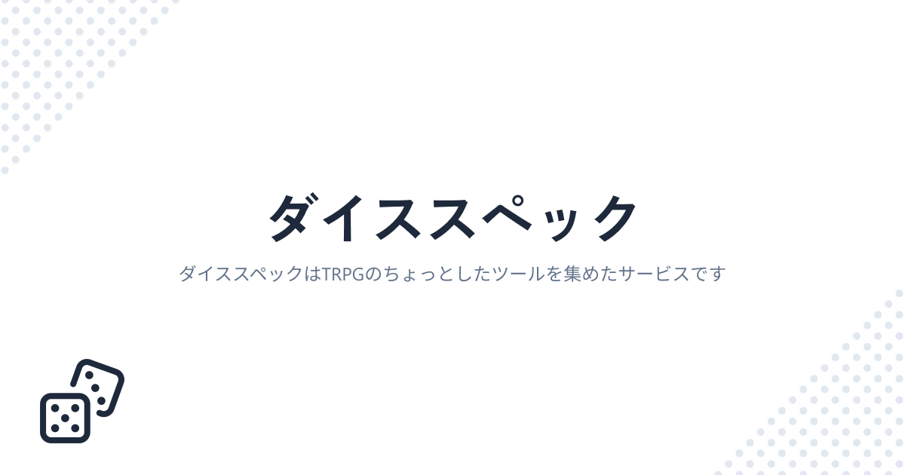

# ダイススペック



## 概要

### どういうアプリ？

TRPGのちょっとしたツールをまとめたようなアプリです。現在は以下のような機能を備えています。

- **ダイス予測**
  - ダイスの期待値や確率を計算します
- **ダイスロール**
  - シンプルなダイスロールおよびBCDiceを使ったダイスロールができます
- **ログ解析**
  - ココフォリアのルームログからダイスの出目を解析します (クトゥルフ神話TRPG 6版・7版、エモクロアTRPG、シノビガミ、ネクロニカ、ソード・ワールド2.5に対応)
- **ココフォリア出力**
  - ココフォリアのキャラ出力形式をビジュアルで編集できます

機能追加のリクエストは[サポート用のDiscordサーバー](https://discord.gg/YQ7negGTUK)までお願いします。

## 環境セットアップ

必要なもの: Node.js、pnpm

```sh
pnpm install
pnpm dev
```

### 依存パッケージの監査

既知の依存関係の脆弱性は `pnpm audit` で確認します。
原則として依存元の互換範囲内で修正版へ更新し、修正版が範囲外でのみ提供される場合は `pnpm-workspace.yaml` の `overrides` で対象範囲を限定します。
更新後は型チェック・ビルドと、影響する CLI・SDK の既存テストで互換性を確認します。

## リポジトリの設計

### ディレクトリ構成

```
src
├── app       # Next.jsのルート、画面固有UI、機能の組み立て
├── features  # 機能ごとのドメインロジックと外部サービス連携
├── shared    # 機能に依存しないUI、ライブラリ、基盤コード
└── test      # 複数のテストから使う補助コード
```

`app` はルーティングと機能の組み立てを担当します。
画面内だけで完結する表示状態とコンポーネントは、対象ルートの `_components` に置きます。

`features` はログ解析、期待値計算、アカウント、プロフィール、Stripeなどの機能単位で分けます。
計算規則、永続化、外部APIとの契約は、利用する画面ではなく所有する機能に置きます。

`shared` は特定機能を知らないコードだけを置きます。
Firebaseの初期化や汎用UIは含みますが、ユーザー購読や解析保存などの機能固有処理は含みません。

### 依存方向

依存方向は `app -> features -> shared` を基本とします。

- `app` は `features` と `shared` を利用できます。
- `features` は `shared` を利用できますが、`app` を参照できません。
- `shared` は `app` と `features` を参照できません。
- 機能間の依存は、`account` や `profile` のように複数機能を調整する処理に限定します。

この依存方向と循環依存は Oxlint で検査します。
機能ロジックを変更するときは、同じディレクトリに正常系と異常系のテストを追加します。
